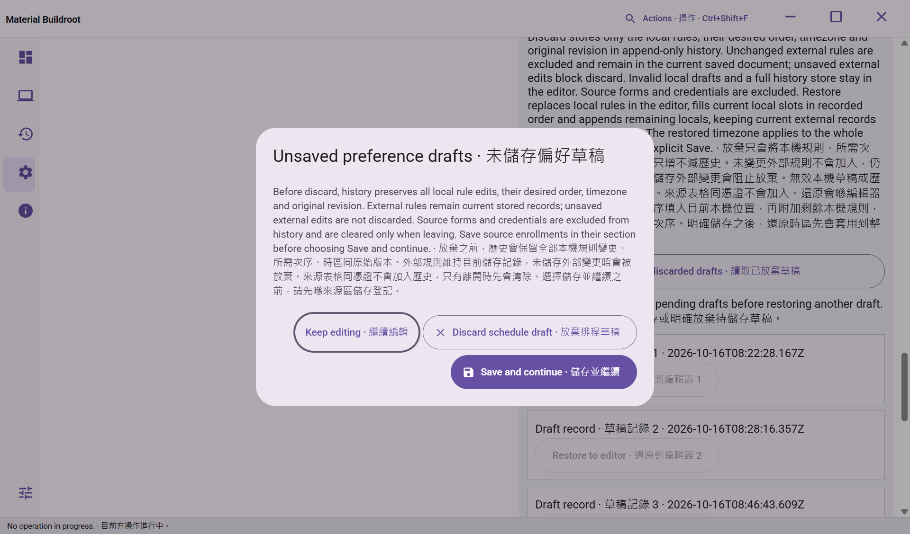

# Material Buildroot

A Material Design 3 desktop workspace for configuring and building embedded Linux systems through WSL 2 or Docker.

[Interactive documentation](https://ding-ding-projects.github.io/material-buildroot/) · [Latest Windows release](https://github.com/Ding-Ding-Projects/material-buildroot/releases/latest) · [Public screenshot gallery](https://ding-ding-projects.github.io/material-buildroot/gallery/) · [Capture provenance](docs/evidence/modern-workspace/README.md) · [Roadmap](ROADMAP.md)

## A productive desktop workspace

An activity rail, project explorer, editor tabs and resizable output dock keep projects and their results together. Bundled Material icons identify navigation and editor actions. Package dependencies and guest topology have interactive canvases with pan, zoom, fit, keyboard movement and separate layout history.

Practical onboarding creates a saved plan and preserves setup progress. Native folder selection connects trusted sources and separate outputs. Package discovery reads actual source declarations; reviewed imports preserve unsupported recipes. Runtime choices and ordered external trees persist, while filesystem and execution authority must be renewed after restart.

The local assistant exposes managed Ollama controls, actual installed-model metadata and measured capacity evidence. Offline help packages the public articles with formatted reading, topic navigation and isolated local search. The documentation website adds guided tasks, recipe previews, troubleshooting and saved browser progress.

The host provides [separate local schedule draft recovery](docs/security/schedule-draft-recovery.md), with append-only bounded storage and explicit restoration that does not activate settings. The [schedule editor](docs/features/scheduled-preferences.md) now includes local rules, effective preferences, protected source enrollment and explicit recovery. All 20 current browser cases passed against the real SQLite service and typed bridge. Current packaged Windows interaction and the complete UI matrix remain pending.

## Interface captures

### Current native dialog evidence

The Windows build at `e722cf1b91ccc46465eb449df4abd84d9d6df2a1` shows the settled unsaved-preference dialog with all three bilingual actions contained and the final action wrapped onto a second row. This is one light-theme state at 1280×752 logical pixels and observed 150% scale, not full product acceptance. The [native receipt and limits](docs/evidence/native-windows-20261016/README.md#settled-dialog-actions-at-e722cf1) retain source, executable and capture hashes, measured geometry and bounded observation.



### Historical workspace coverage

These are genuine, unretouched Linux Chromium captures of renderer source `e8f9beb`. Workspace storage and the offline documentation service are real; native-operation boundaries use explicit fixtures. Later shared-preference and queue/catalogue controls are not shown in this retained set. The [capture manifest](docs/evidence/modern-workspace/README.md) records exact source and image hashes, capture clocks, language/theme/viewport and each workflow's verification limit. The [public gallery](https://ding-ding-projects.github.io/material-buildroot/gallery/) also preserves reviewed historical application and website originals. These captures do not establish current packaged Windows acceptance.

### Package dependency canvas


### Guest topology


### Source management


### Configuration


### Runtime and project setup


### Builds and output


### Built-in tools


### Local assistant


### Read-only companion


### Offline documentation


### Settings and recovery


### Resumable onboarding


[Historical screenshots and their original provenance](docs/evidence/ARCHIVE.md) are retained separately.

## Scope and verification

The full product remains in active implementation. Windows testing resumed on 2026-10-16: the exact desktop build and six native build-toolchain checks passed, and the actual packaged workspace and runtime-discovery action ran on an isolated hidden desktop. The initial complete native test baseline failed; reviewed portability repairs are being delivered in focused batches. See [native continuation evidence](docs/evidence/native-windows-20261016/README.md) for exact sources, counts and remaining gaps. Source implementation, browser fixtures, packaging and full native acceptance remain separate evidence. The [workspace guide](docs/desktop/modern-workspace.md) describes actual behavior and limits; the [roadmap](ROADMAP.md) retains missing functionality and acceptance requirements.

Buildroot runs in a non-root Linux runtime. Docker requires an existing digest-pinned image. External converters and PDF tools require admitted payloads and verified isolation. Companion pairing requires browser-trusted TLS and native owner approval. Downloading an update does not install it. Existing sources, outputs and protected data are preserved.

## Build

```powershell
.\build.bat /s
.\build-installer.bat /s
.\build.bat --target documentation /s
```

The root entrypoints acquire pinned portable tools and locked packages without administrator rights. `build.bat --run` explicitly builds and launches the application. The unsigned Squirrel.Windows installer can trigger publisher or SmartScreen warnings. Build scripts produce artifacts; publication is a separate workflow.

The documentation target validates isolated generated output before promotion into `docs/`. GitHub Pages serves `main` → `/docs`. See [Windows entrypoints](docs/build/windows-entrypoints.md), [website authoring](website/README.md) and [the current handoff](HANDOFF.md).
