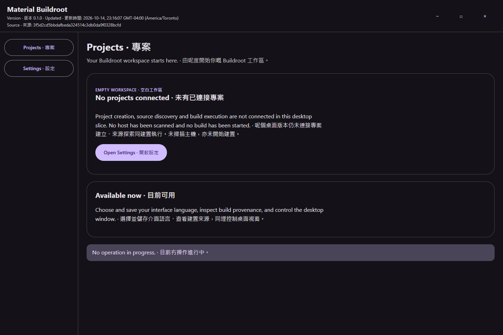
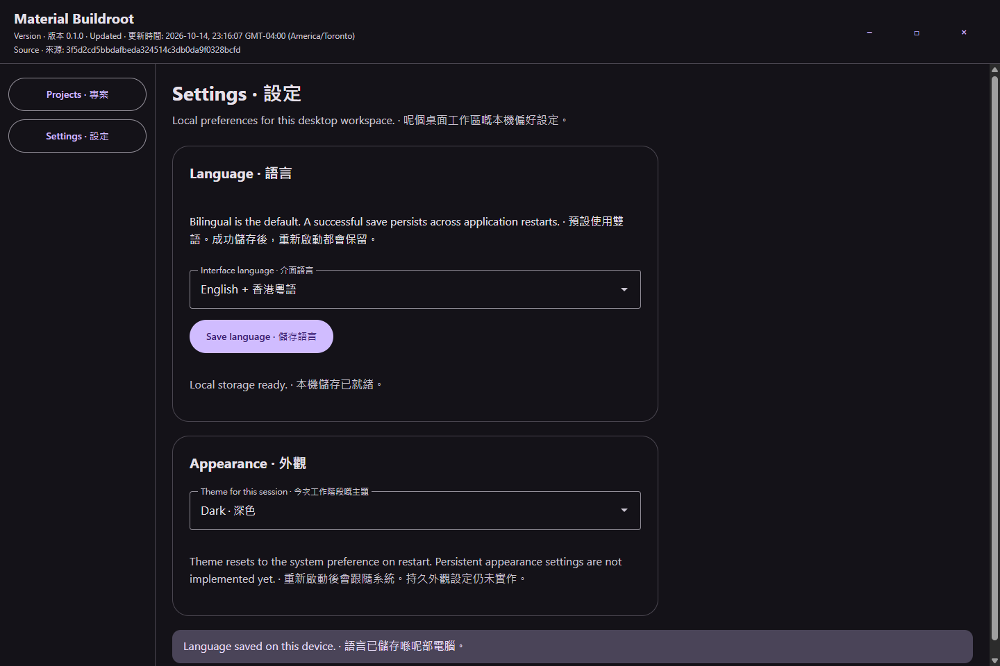

# Material Buildroot

## Download version 0.1.0

Automatic workflow [38682722692](https://github.com/Ding-Ding-Projects/material-buildroot/actions/runs/38682722692) subsequently completed successfully and created normal release `v0.1.0-build.1.1`. This supersedes the in-progress observation below. The verified `v0.1.0` direct download remains stable.

[Download the unsigned Windows x64 installer](https://github.com/Ding-Ding-Projects/material-buildroot/releases/download/v0.1.0/Setup.exe). [Version 0.1.0: Classic Har Gow · 蝦餃](https://github.com/Ding-Ding-Projects/material-buildroot/releases/tag/v0.1.0) is a normal, non-draft, non-prerelease release bound to source `0881a3a3f58c85bf73f57035b3a09da3acbbe1a8`. All five uploaded assets matched their local sizes and SHA-256 digests. The [public dish photo](https://github.com/Ding-Ding-Projects/dim-sum-photos/releases/download/catalog-v1/hk-dish-0001-classic-har-gow.png) remains in its owning catalog.

This is an early desktop shell with durable language preferences. Project creation, Buildroot execution and automatic updates remain unimplemented. The genuine Squirrel.Windows installer is unsigned and may trigger unknown-publisher or SmartScreen warnings. Bounded installed launch and package identity were verified; setup exit code, signer-process audit and update-pair acceptance remain unavailable. Automatic workflow 38682722692 was still running at this record boundary.

A Windows desktop workspace in development for configuring Buildroot and running builds through WSL 2 or Docker Linux containers.

The packaged desktop shell now opens a genuine empty-project workspace and saves English, Hong Kong Cantonese or bilingual language preferences through a narrowly scoped durable broker. Appearance choices are explicitly session-only. Project creation, Buildroot execution, virtual-machine workflows, encrypted publication and the authenticated companion remain unimplemented. The [phased checklist](ROADMAP.md) preserves the wider scope and its separate evidence requirements.

The current bounded runtime evidence is tied to source `3f5d2cd5bbdafbeda324514c3db0da9f0328bcfd`. Twenty-six host/preload/broker checks passed on the earlier `aa91c34f4588a0dae85faef169c4dcf542c307d0` candidate; those host/preload/session sources were unchanged by the final renderer-only repairs. Six build-tool checks passed on the current source. The settings matrix covered 48 language/theme/viewport/runtime-scale tuples; 52 layout receipts passed, including four startup receipts. Language persistence was verified across actual executable restarts. Read the [desktop article](docs/desktop/host-and-preferences.md) and [capture evidence](docs/evidence/desktop-shell/README.md) for exact limitations. These results do not establish complete product, installer or release acceptance.

The [documentation website](https://ding-ding-projects.github.io/material-buildroot/) is hosted from `main` → `/docs`, and the stored repository homepage matches that address. The isolated documentation build includes the current desktop articles and captures, all nested documentation and the complete source wiki. Its 69-page build passed 1,578 internal link/asset/fragment checks, and 20 browser runtime tuples passed observed checks. Strict browser audit acceptance remains incomplete because automatic approval rejected temporary-profile deletion. See issue 1 for the final publication revision and live byte verification. Historical [initial hosting evidence](docs/evidence/hosting/initial-live.json) remains historical. The bounded desktop installer is now available above.

## Build

```powershell
.\build.bat /s
.\build.bat --target documentation /s
```

The root entrypoints acquire pinned portable tools and locked packages without administrator rights. The earlier desktop build produced the source-bound packaged executable at `release/app/win-unpacked/Material Buildroot.exe`; its build-receipt SHA-256 is `21e9109880510ef4fde2b561e728195b7de0dd09bbeb0fdfa3ea01a415ea92d1`. An explicit `.\build.bat --run` builds and launches the desktop. Version 0.1.0 has separate installer production and bounded installed-launch evidence; complete native/update acceptance remains open.

The documentation target builds and validates isolated `.cache/documentation-output/` files before a separate reviewed promotion into `docs/`. See [website build instructions](website/README.md) and [Windows build boundaries](docs/build/windows-entrypoints.md). The design-reference target remains synthetic material, not production evidence. No fresh-operating-system success is claimed.

Buildroot itself runs inside Linux. WSL projects should live on the distribution's Linux filesystem for predictable case sensitivity and performance. Docker projects use a dedicated Linux container with separate output storage. Neither execution route has been accepted in the current product.

Read [PLAN.md](PLAN.md), [DECISIONS.md](DECISIONS.md), [HANDOFF.md](HANDOFF.md) and [NEXT_SESSION.md](NEXT_SESSION.md) before continuing implementation.

## Verified desktop shell captures

The packaged shell was captured from source `3f5d2cd5bbdafbeda324514c3db0da9f0328bcfd`. These images show the empty workspace and saved bilingual language settings. Read the [capture evidence and limitations](docs/evidence/desktop-shell/README.md) for the 48-tuple matrix, 52 validated layout receipts, source hashes, runtime-scale boundary and remaining product work.




