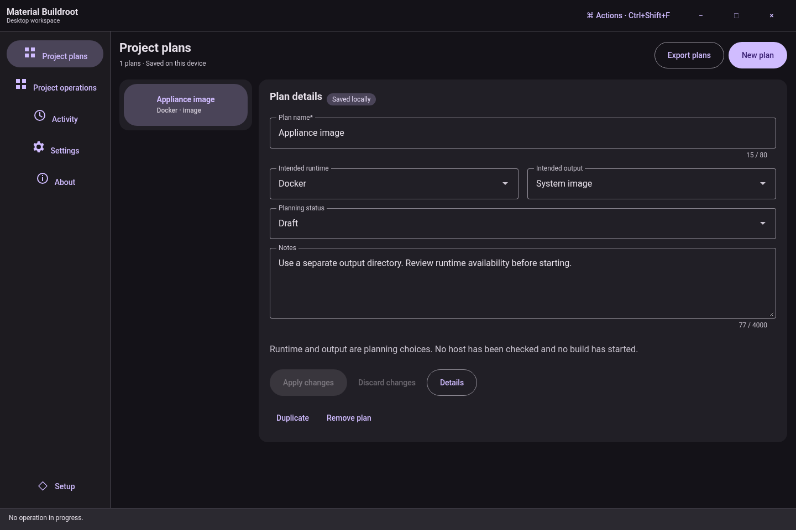
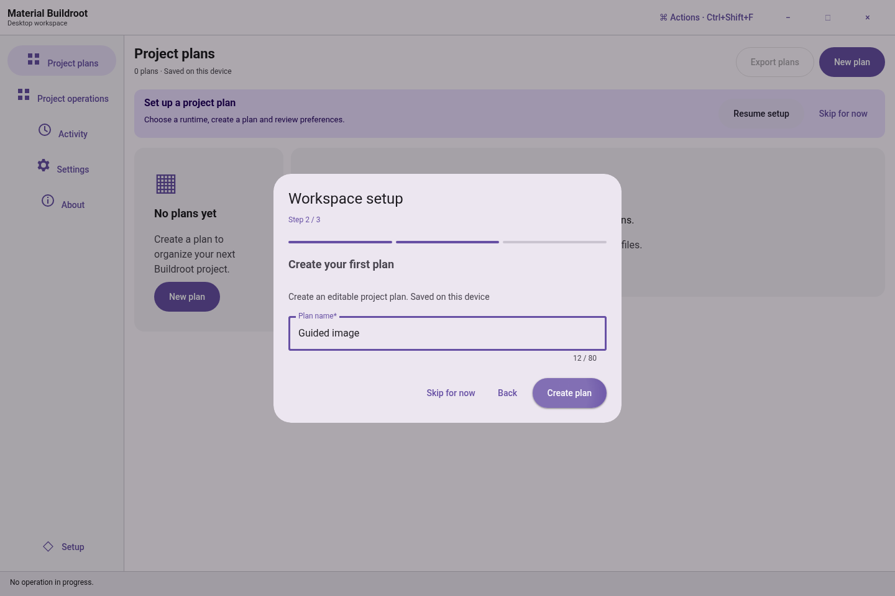

# Material Buildroot

A Material Design 3 desktop workspace for planning, configuring and building embedded Linux systems through WSL 2 or Docker.

[Documentation website](https://ding-ding-projects.github.io/material-buildroot/) · [Latest Windows release](https://github.com/Ding-Ding-Projects/material-buildroot/releases/latest) · [Current screenshot gallery](https://ding-ding-projects.github.io/material-buildroot/site/articles/docs/evidence/modern-workspace/README.html) · [Complete roadmap](ROADMAP.md)

## Working workspace

Practical onboarding creates a saved project plan. Plans, setup progress, appearance and snapshots persist locally. The workspace provides native project adoption, durable build jobs and logs, typed Kconfig controls, artifact inspection, managed guest controls, local-model chat, verified update downloads and an isolated regex workbench.

Typed tools use native file selection and durable queues. The companion panel configures explicit HTTPS pairing for read-only workspace, project and job summaries. The separate website provides complete documentation and a local visitor workbench with its own state.





These are genuine Linux Chromium source previews of the real renderer at source `7c14df3`. Workspace cases use the actual local storage service. They are not packaged Windows captures. The [gallery and capture manifest](docs/evidence/modern-workspace/README.md) include English, Hong Kong Cantonese, bilingual, light/dark and compact layouts, with separate tool and companion component fixtures.

## Scope and verification

The full product is in active implementation. Windows runtime testing is deferred by owner direction. Source implementation, browser fixtures, remote Windows packaging and native acceptance are separate records. The [workspace guide](docs/desktop/modern-workspace.md) describes actual controls and limits; the [roadmap](ROADMAP.md) retains unimplemented requirements and missing acceptance.

Buildroot uses non-root Linux runtimes. Native Windows make, arbitrary renderer commands and implicit source execution are prohibited. Docker requires an existing digest-pinned image. External converters and PDF tools require admitted payloads plus verified isolation. Companion pairing requires browser-trusted TLS and native owner approval. Downloading an update does not install it. Existing source, outputs and protected data are preserved.

## Build

```powershell
.\build.bat /s
.\build-installer.bat /s
.\build.bat --target documentation /s
```

The root entrypoints acquire pinned portable tools and locked packages without administrator rights. `build.bat --run` explicitly builds and launches the application. The unsigned Squirrel.Windows installer can trigger publisher or SmartScreen warnings. Build scripts produce artifacts; publication is a separate workflow.

The documentation target validates isolated generated output before reviewed promotion into `docs/`. GitHub Pages serves `main` → `/docs`, and the repository homepage points to the exact deployed root. See [Windows entrypoints](docs/build/windows-entrypoints.md) and [website authoring](website/README.md).

[Historical screenshots and release evidence](docs/evidence/ARCHIVE.md) are retained separately.

Read [PLAN.md](PLAN.md), [DECISIONS.md](DECISIONS.md) and [HANDOFF.md](HANDOFF.md) before continuing implementation.
