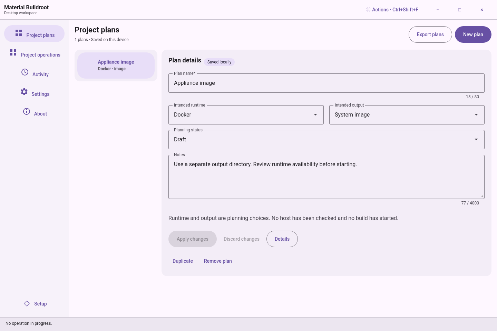
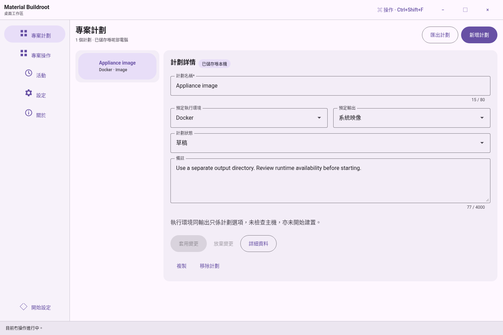
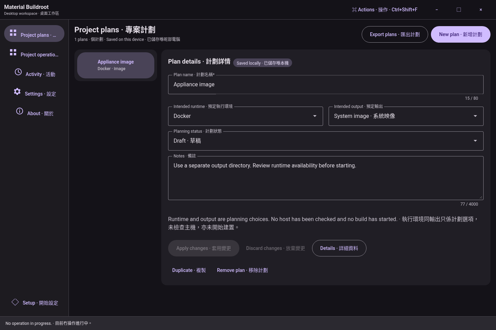
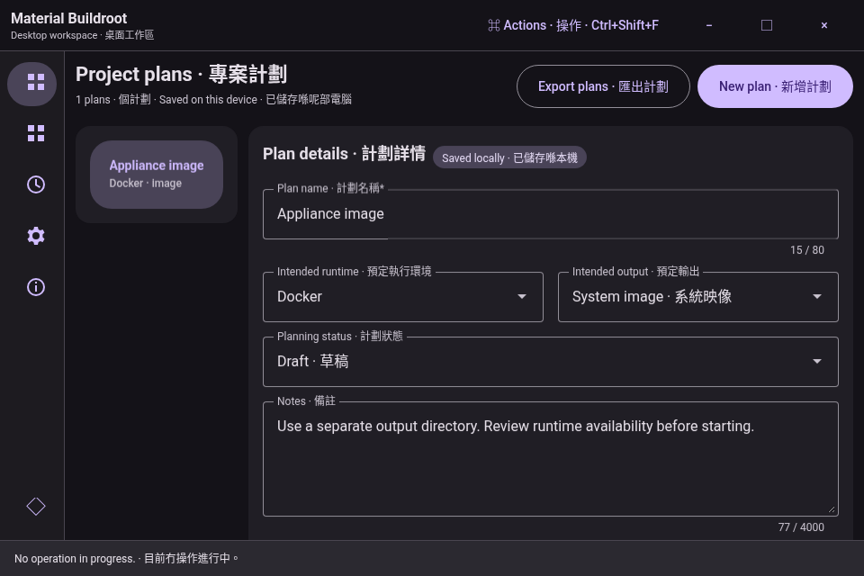
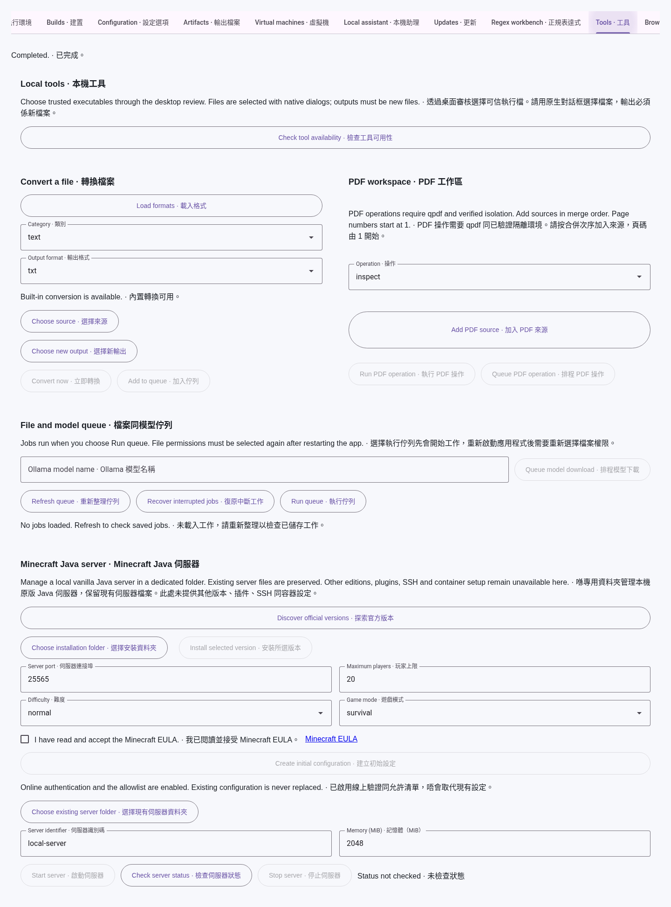
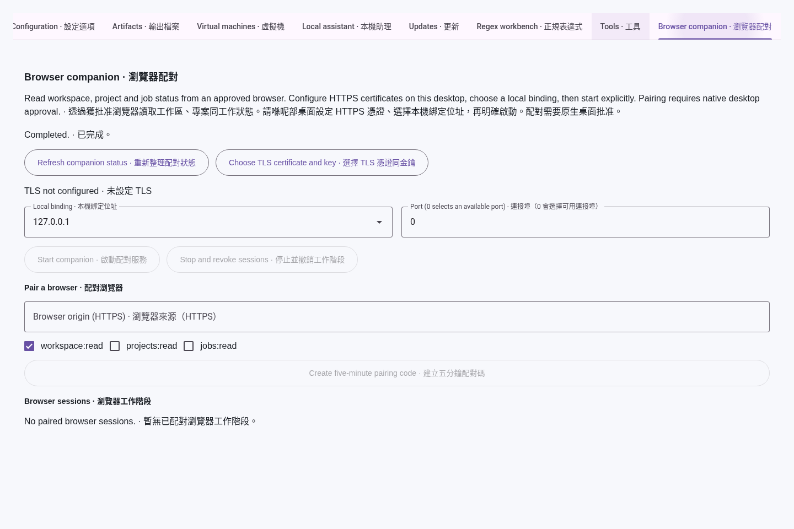
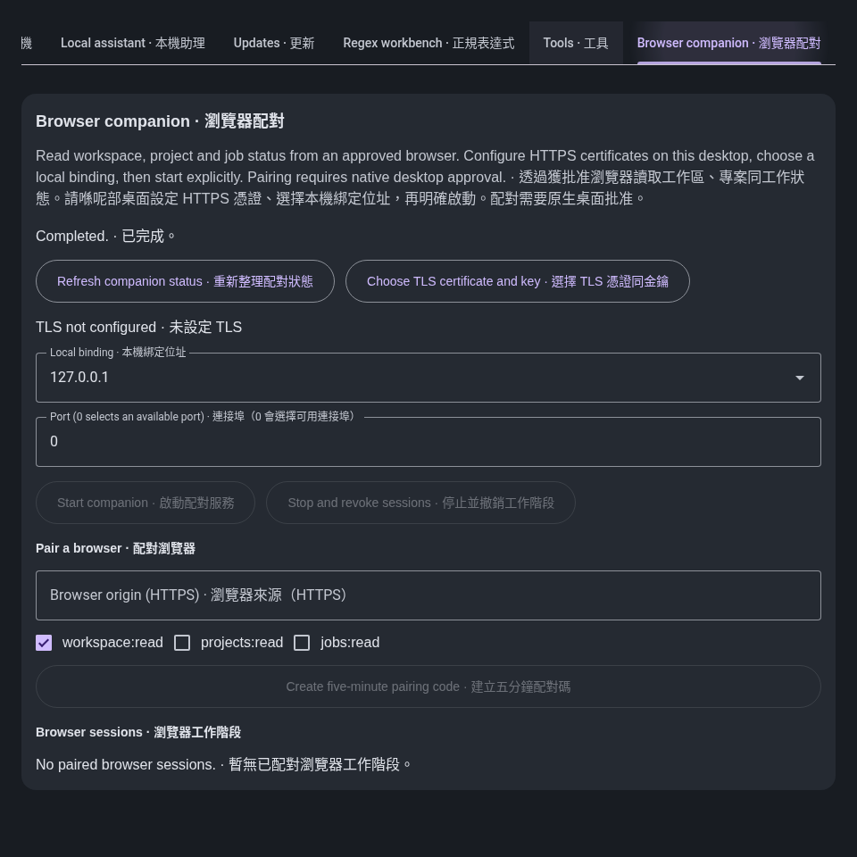

# Historical screenshot archive

Earlier captures are retained with their original source and verification boundaries. They are historical evidence; the source README and current gallery show the latest reviewed interface.

## Earlier workspace source previews

These genuine, inspected Linux Chromium source previews document application source `7c14df34ffe785e2a7e108b17f839e15668d1183`. They are browser captures of the real renderer, not packaged Windows captures. No image has been composited or retouched.

The workspace and onboarding fixtures use the actual local workspace service. Tools and companion captures use typed fixture replies and show the panels before native configuration. They do not prove file-picker, executable, TLS, LAN, build, guest or installer behavior. Native Windows runtime verification is deferred.

The renderer suite passed 52 cases. A separate passing onboarding recapture waited for the Material field transition to finish before taking the image. [Capture hashes, dimensions, source bindings and timestamps](modern-workspace/captures.json) retain the exact scope. [Earlier packaged Windows captures](desktop-shell/README.md) remain historical.

## Workspace and practical setup

### Workspace, English, dark, 1440 × 960

### Workspace, English, light, 1440 × 960

### Workspace, Hong Kong Cantonese, light, 1440 × 960

### Workspace, bilingual, dark, 1440 × 960

### Workspace, bilingual, dark, 960 × 640, scrollable editor

### Tools component fixture, bilingual, light, full-page capture

### Companion component fixture, bilingual, light, unconfigured

### Companion component fixture, bilingual, dark, unconfigured

### Practical onboarding, English, step 2, real saved-plan workflow

## Earlier packaged desktop

[Original Windows desktop captures and release receipts](desktop-shell/README.md) retain their exact source, dates and verification limits.
