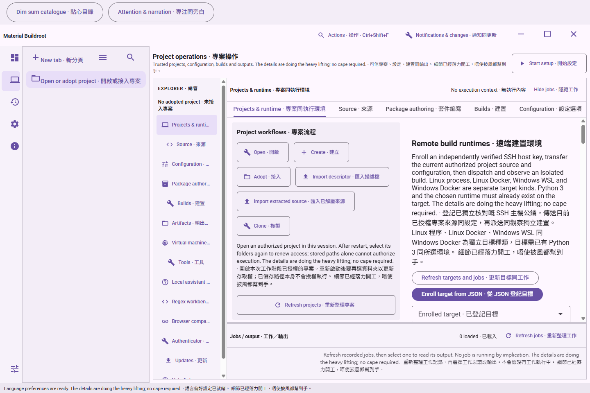
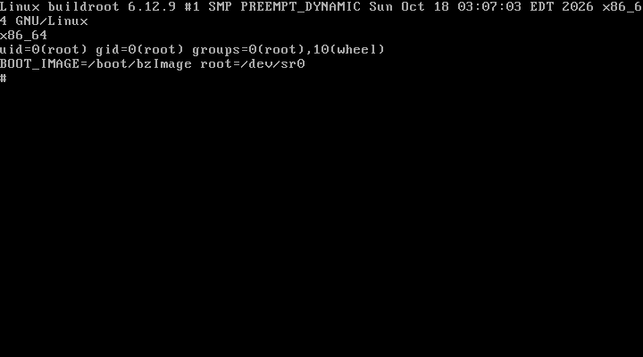

# Historical screenshot archive

Earlier captures are retained with their original source and verification boundaries. They are historical evidence. The source README records the current interface and its outstanding evidence requirements; gallery publication does not make these older images current.

## Earlier workspace source previews

These genuine, inspected Linux Chromium source previews document application source `7c14df34ffe785e2a7e108b17f839e15668d1183`. They are browser captures of the real renderer, not packaged Windows captures. No image has been composited or retouched.

The workspace and onboarding fixtures use the actual local workspace service. Tools and companion captures use typed fixture replies and show the panels before native configuration. They do not prove file-picker, executable, TLS, LAN, build, guest or installer behavior. Native Windows runtime verification is deferred.

The renderer suite passed 52 cases. A separate passing onboarding recapture waited for the Material field transition to finish before taking the image. [Capture hashes, dimensions, source bindings and timestamps](modern-workspace/captures.json) retain the exact scope. [Earlier packaged Windows captures](desktop-shell/README.md) remain historical.

## Workspace and practical setup

### Workspace, English, dark, 1440 × 960

### Workspace, English, light, 1440 × 960

### Workspace, Hong Kong Cantonese, light, 1440 × 960

### Workspace, bilingual, dark, 1440 × 960

### Workspace, bilingual, dark, 960 × 640, scrollable editor

### Tools component fixture, bilingual, light, full-page capture

### Companion component fixture, bilingual, light, unconfigured

### Companion component fixture, bilingual, dark, unconfigured

### Practical onboarding, English, step 2, real saved-plan workflow

## Earlier packaged desktop

[Original Windows desktop captures and release receipts](desktop-shell/README.md) retain their exact source, dates and verification limits.

## Superseded interface images previously embedded in the README

The following originals were moved out of the README presentation when the guided interface replaced the previous shell. Their bytes, filenames, original manifests and historical verification boundaries are unchanged. A directory named `current` below is an original historical path, not a claim of current interface coverage.

The twelve workspace images below belong to the 24-image capture group at source `e8f9bebf2b96397b00000be485870a61c16cb3e2`. Its run began at `2026-10-15T21:31:33.702Z` and ended at `2026-10-15T21:31:45.687Z`. The [original manifest](modern-workspace/current/captures.json) has SHA-256 `8df213e5a7d39fce3bdcbe2ac8ad78c8241c3c9193721deedef8cb66a6d0d9c4`. The [complete original gallery](modern-workspace/README.md) preserves all 24 images and exact fixture limits. These original captures are renderer source previews, unlike the separately recorded later built-renderer captures.

### Earlier native dialog evidence

The Windows build at `e722cf1b91ccc46465eb449df4abd84d9d6df2a1` shows the settled unsaved-preference dialog with all three bilingual actions contained and the final action wrapped onto a second row. This is one light-theme state at 1280×752 logical pixels and observed 150% scale, not full product acceptance. The [native receipt and limits](native-windows-20261016/README.md#settled-dialog-actions-at-e722cf1) retain source, executable and capture hashes, measured geometry and bounded observation.

### Historical workspace coverage

These are genuine, unretouched Linux Chromium captures of renderer source `e8f9beb`. Workspace storage and the offline documentation service are real; native-operation boundaries use explicit fixtures. Later shared-preference and queue/catalogue controls are not shown in this retained set. The [capture manifest](modern-workspace/README.md) records exact source and image hashes, capture clocks, language/theme/viewport and each workflow's verification limit. The [public gallery](https://ding-ding-projects.github.io/material-buildroot/gallery/) also preserves reviewed historical application and website originals. These captures do not establish current packaged Windows acceptance.

### Package dependency canvas

### Guest topology

### Source management

### Configuration

### Runtime and project setup

### Builds and output

### Built-in tools

### Local assistant

### Read-only companion

### Offline documentation

### Settings and recovery

### Resumable onboarding

## Installed startup repair at version 0.1.1

The installed workspace image records source `21bf4ad4c6e1fb19a8a48fae57cdca6d63777c6a`, version 0.1.1, build 233.1. It is bounded startup evidence, not the guided interface. Preserve the [original inventory](startup-repair/inventory.json), [runtime receipt](startup-repair/runtime-smoke.json) and [release](https://github.com/Ding-Ding-Projects/material-buildroot/releases/tag/v0.1.1-build.233.1). Dates and individual image hashes remain those in the original evidence.

## Earlier generated ISO console

This console belongs to the separately recorded 12,357,632-byte BIOS GRUB2 ISO with SHA-256 `1d75d40b94e3c441aaaead9109f8074f62334931e1d84a576f3d7a36ec566dba`. Its [production evidence](iso-production/README.md) and [boot evidence](iso-boot/README.md) retain the exact source, runtime profile and capture provenance. It is output-image boot evidence, not a screenshot of the current desktop interface.

