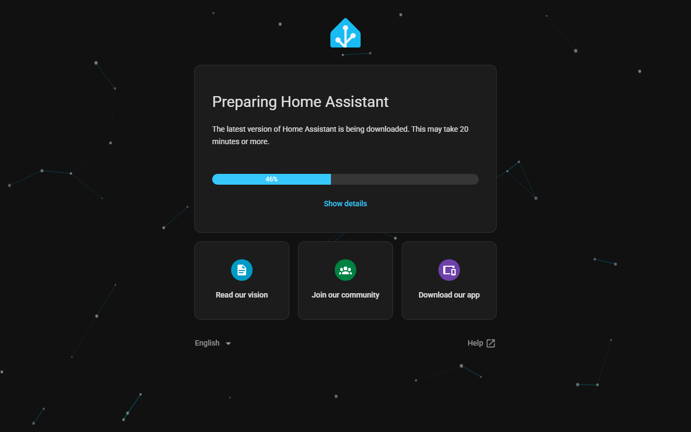
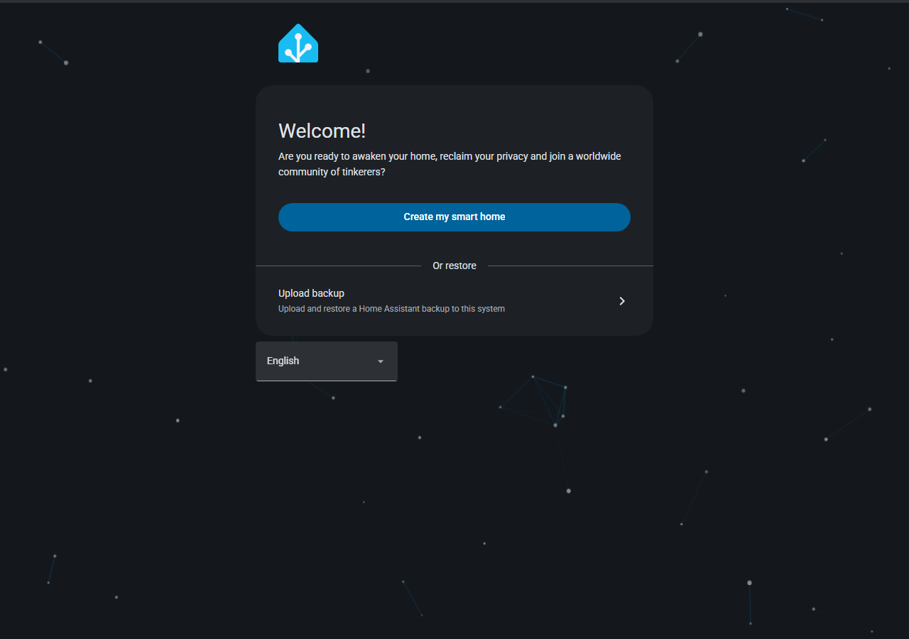
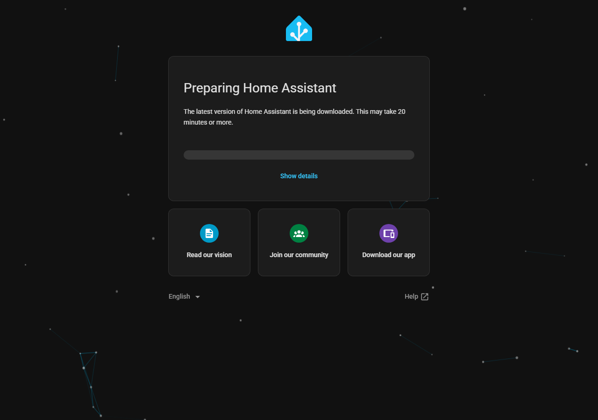

# External tree image builds: verification record

This page records what was actually run for the [external tree image route](../../features/external-tree-images.md). Anything not listed here has not been verified.

## Host and source

- Windows 11 with Docker Desktop (engine 29.6.1, context `desktop-linux`, 32 CPUs and 31 GiB memory available to Docker, KVM available to containers).
- Source: the Home Assistant Material repository at commit `4342caf5617ca2e1a31a7fd9985b3b8549874223`. Its tree is HAOS 18.5 with 14 board defconfigs, and its core version is 2026.11.1.

## Operating system image: `ova`, recorded 2026-11-11

Run with `node scripts/haos/build-haos.cjs --source <repository> --defconfig ova --output <folder>`.

| Step | Exit | Duration |
| --- | --- | --- |
| Builder image from the committed tree | 0 | 14 s |
| Build and cache volumes | 0 | under 1 s |
| Source export (`git archive`, committed bytes) | 0 | 2 s |
| `make ova` in the tree's builder | 0 | 93 min 35 s |
| Collect `haos_*` | 0 | 51 s |
| Remove build volume and builder tag | 0 | 41 s |

| File | Bytes | SHA-256 |
| --- | --- | --- |
| `haos_ova-18.5.ova` | 617,871,360 | `4b2ce140ca4d08d09a42c874c520bb2ee44f45bc5087fe1eda97c71b186e2fc9` |
| `haos_ova-18.5.qcow2.xz` | 545,952,500 | `7bc734ef5d92478459f2453b4e4f3695c306af9c30462f6b11a6a210f0198f7c` |
| `haos_ova-18.5.raucb` | 235,052,571 | `101e12710c9262fde32b126caa7f318fcc41d4915a24a186f2bd9170455e9bcf` |
| `haos_ova-18.5.vdi.zip` | 602,398,027 | `244dce9cbe8af1f9cd5050f80917ba49f9ca05a105203a4acf0cd69a03207b0f` |
| `haos_ova-18.5.vhdx.zip` | 602,666,508 | `e17e12d2d1b0da438ed69d527d372429090c1d055008721a41108de7ad59beb5` |
| `haos_ova-18.5.vmdk.zip` | 602,412,018 | `7dc1278fc7e70952b050389de3257dded6e755d17b056cc831f6d6d42e3e72d6` |

The version feed was the live channel feed. No release signing key was provided, so the update bundle is signed with a one-time key and will not install over a released system.

### Boot check

The decompressed `qcow2` was booted with QEMU, KVM and UEFI (OVMF) inside a throwaway container, using a copy of the disk:

- Port 8123 answered after about 40 seconds with a redirect to port 80.
- Port 80 then served the Home Assistant landing page.
- The landing page reported that it was downloading Home Assistant Core.

This shows that the image boots, that the Supervisor starts, and that the Supervisor reads the channel feed.

About 35 minutes after boot, the Supervisor had downloaded and started Core from the Home Assistant Material channel feed. Port 80 then redirected to `/onboarding.html`, and `/api/onboarding` listed the user, core configuration and integration steps as not done. Which Core build the feed named was not identified from outside the guest.

## Operating system image with images built from source: `ova`, recorded 2026-11-12

Run with `node scripts/haos/build-haos.cjs --source <repository> --defconfig ova --commit 311d3508ad61da723de1ab7a561de1c50f0c8ceb --output <folder>` on the same host. The source is the Home Assistant Material commit of release 2026.11.1.132. The live channel feed was read once at the start (`channel/stable.json`, Supervisor `2026.11.0.132`) and passed to `make` as the pinned version file.

| Image | Built from | Digest stored and found in the OS image |
| --- | --- | --- |
| `ghcr.io/ding-ding-projects/amd64-hassio-supervisor:2026.11.0.132` | `supervisor/` at `311d3508` | `sha256:641c297b8330a091b099c22cd5ea5df9dda82073abe59b4c0382eacb6c3b3ac2` |
| `ghcr.io/ding-ding-projects/qemux86-64-homeassistant:landingpage` | `landingpage/` at `311d3508` | `sha256:d2e69fe3851cd91760af4d4975c4b3e3f17bc3b7fa36149a08a4b25764841919` |

The tree's recipe printed `Fetching image: … (digest …)` with exactly these digests, and the run checks that before it collects the files. The upstream plug-ins (`amd64-hassio-audio` 2026.10.0, `-cli` 2026.10.1, `-dns` 2026.10.0, `-multicast` 2026.10.0, `-observer` 2026.08.0) were downloaded by the recipe (here from its download cache).

`make ova` took 44 min 22 s with the compiler cache from the earlier build.

| File | Bytes | SHA-256 |
| --- | --- | --- |
| `haos_ova-18.5.ova` | 637,204,480 | `86a9f51ce4f89b94ad5e301615d3b2db89d3094b544f0da5626b5d8f42781d32` |
| `haos_ova-18.5.qcow2.xz` | 565,641,376 | `6ddaaf78c1c88a7feb37d7290369c4d9c1814daad21d245cf724d59094587cd4` |
| `haos_ova-18.5.raucb` | 235,052,571 | `e2441419f886bc91c43c6af1f01d33cfb23f4810170d65ccfd7e585a3b3135fd` |
| `haos_ova-18.5.vdi.zip` | 621,509,634 | `a750cc856dd112ff8b559bcd02251693488d158b2bcdf47103b519b0cdf1774e` |
| `haos_ova-18.5.vhdx.zip` | 621,789,197 | `3d12545afe59026966f90496d87f82ff70cbed873cf1204d1f29b8b0ede08bc7` |
| `haos_ova-18.5.vmdk.zip` | 621,532,146 | `b6b275cfde0fd2ca8ad980613898815f93a180c5facb6f0a489c9e2036ed6478` |

Afterwards the private registry, its network, the build-only tags, the build volume and the builder tag were gone; only the shared cache volume was left.

Two earlier attempts on the same day failed and were fixed before this run:

- Copying into the registry through a port published on this computer failed (`connection refused`): Docker Desktop's engine does not reach a port published on the Windows loopback. The images are now copied with `skopeo` inside the build network and no port is published.
- `make` stopped with `cat: /build/version-pinned.json: Permission denied`. The pinned version file was written by root and read by the builder user. It is now handed to the builder user. This also affected `--version-json` before this change.

### Boot check

The decompressed `qcow2` was booted in a throwaway container with QEMU and UEFI (OVMF). KVM was not available to containers on this host that day, so QEMU ran with software emulation (TCG, 4 vCPUs).

- Port 80 served the landing page about 4 minutes after start, and port 8123 redirected to it.
- The page reported that the latest Home Assistant was being downloaded, and the Supervisor log showed it loading the add-on store.

The Supervisor and landing page that answered are the ones built from source, since those are the only copies in the image. The download of Core that follows comes from the update feed and is not part of the image; it was not waited for.

## Container image: `home-assistant-material:local`, recorded 2026-11-11

Run with `node scripts/haos/build-container-image.cjs --source <repository> --work <folder> --save <file.tar>`.

| Step | Result |
| --- | --- |
| Stage (shared clone, sparse checkout of `core`, `frontend`, `build`, `versions.json`) | pass, 59 s |
| Frontend wheel | pass, 37 s with cached layers (982 s on the first run) |
| Translations from the pinned upstream image | pass |
| Core image | pass, 529 s |
| Inspect | `sha256:600262a5d7a7b427ea569175824970c5fc3243a522a41241e03d8bdf583a81be`, 866,014,149 bytes |
| Save | `home-assistant-material-local.tar`, 866,046,976 bytes, SHA-256 `0f304e01f5f4bf8db0109297acdb03f267740ba26baa67931060723c6f09c971` |

The image was then run on a loopback port:

- `/manifest.json` answered HTTP 200 within 10 seconds.
- `/api/onboarding` listed the user, core configuration and integration steps as not done.
- The image labels carry core `2026.11.1` and revision `4342caf…`.

The container was then removed. Nothing was pushed.

## Desktop route, built application

The application was built from `2f44386` and run on a hidden desktop with an isolated profile. It was driven through its own page and the native folder dialog.

- **Builds view.** The new panel sits at the top of the main column.
- **Choose repository.** Picking the Home Assistant Material repository in the native folder dialog listed `HAOS 18.5 · 14 boards` and `Container image recipe: Found · core 2026.11.1`. The service reported the same 14 defconfigs.
- **Build container image locally.** This started a job that showed its running state, a cancel action, the output folder and a live log.
- **Run on `368e895`.** The job got through staging, the frontend wheel, translations, the core image and inspect. It was then marked failed because removing the staged clone hit `EPERM` (see the defects below).
- **Rerun on `2f44386`.** The application exited during the frontend step, about two minutes after the folder dialog closed. Windows recorded an access violation in `explorerframe.dll_unloaded`, the shell module behind the folder dialog. The dialog had been driven with posted window messages on a hidden desktop. That cause is likely but unproven.

A full successful container build started from the window has therefore not been recorded. The same runner completed the build from the command line above.

Captures of the panel show local user paths, so they are kept outside this repository.

## Defects found while bringing the route up

| Defect | Cause | Fix |
| --- | --- | --- |
| The first `ova` build stopped in Buildroot's kconfig with `syntax error near unexpected token $'\r'`. | Archiving `commit:operating-system` leaves the repository's root `.gitattributes` behind, so a host `core.autocrlf=true` converted every text file to CRLF. | The archive runs with `core.autocrlf=false` and `core.eol=lf`, exporting committed bytes unchanged. The builder image is built from the same archive. |
| Extracting the translations failed with `Cannot connect to C: resolve failed`, then `Cannot open` after `-C`. | GNU tar on Windows reads `C:\...` after `-f` as a remote host and mangles it after `-C`. | `tar` runs in the destination folder with a relative, forward-slash archive path. |
| A container build started from the desktop application succeeded, then was reported as failed and its receipt was never closed. | Git leaves pack files read-only. Electron's Node 24 refuses to remove them on Windows (`EPERM`), and that cleanup sat outside the error handling. | Cleanup clears the read-only flag and retries. A cleanup that still fails is recorded as a warning and never changes the build result. Checked with the shipped Electron in Node mode: plain `rmSync` gives `EPERM`, and the new cleanup removes the folder. |
| The panel first rendered in the 340-pixel admission column. | Placement. | It now sits at the top of the main Builds column. |
| The packaged-Help resource test and the documentation link test already failed on `main`. | The test did not list the `appliance-guest` resource added in `30dfb84`, and `design/README.md` linked CSS files under `src/` that offline Help cannot open. | The test expectation was updated, and the CSS files are named as code paths. |

## Not verified

- A full container build completed from inside the desktop window. See the folder dialog crash above.
- Boards other than `ova`, flashing hardware, and over-the-air updates.
- Completing Home Assistant onboarding inside the booted operating system.
- A signed update bundle.
