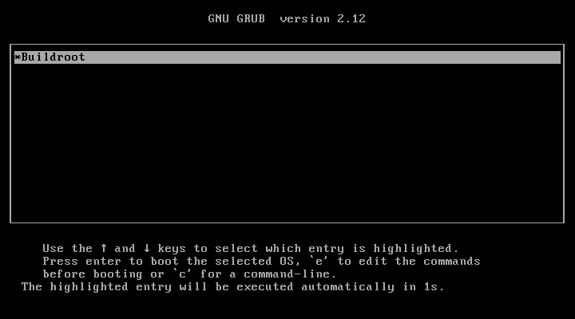
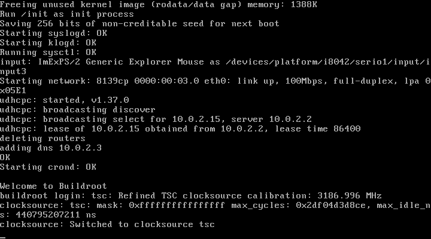
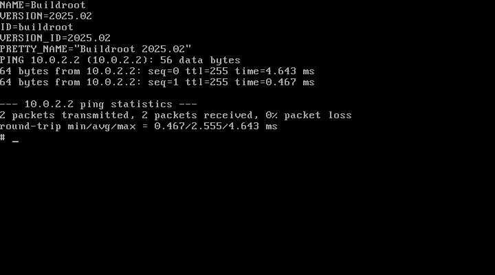

# BIOS ISO boot and console acceptance

The application-created ISO booted through its unchanged BIOS menu, reached a usable Linux console, completed filesystem and basic network checks, and shut down through the guest's `poweroff` command. This acceptance is specific to the consumer profile below. Other tested profiles had real limitations, preserved here rather than hidden.

## Verified profile and binding

- ISO: 12,357,632 bytes, SHA-256 `1d75d40b94e3c441aaaead9109f8074f62334931e1d84a576f3d7a36ec566dba`.
- Product revision: `5431a6275d875428ae50335905107d5951cc6150`.
- Buildroot: 2025.02, selected revision `aa2d7ca53f704af901f6c33c13e4bb1591886700`; archive SHA-256 `33ba6d3f5907e18041a5ed079776cc9269df59703700427f93dc61c3387801c0`. The producer compared 14,709 extracted entries with zero mismatches. Independent upstream authentication is separate.
- Final configuration SHA-256: `0e33a58b7dfbe2099d0cc6027f18dbce99650168936ce56cb5f71934137db51f`. Full producer result: succeeded, exit code 0.
- QEMU package: `1:10.0.13+ds-0+deb13u1`, acquired through Debian's signed apt metadata, pinned to that discovered version. Package and binary hashes are in [acceptance.json](acceptance.json).
- Official Debian image: `debian@sha256:a29215f6a35e51e22adffa17f89e9d2ef06214e64a2bad10d765c46aea49f11f`.
- Consumer: PC BIOS, `qemu64`, one CPU, 512 MiB, `tcg,thread=single`, Cirrus VGA, RTL8139 network adapter. ISO mounted read-only; original boot menu and kernel arguments unchanged.
- QEMU ran as non-root UID 65534 inside a nonprivileged, task-owned container. The container network was disconnected after package acquisition. Guest networking used QEMU's internal SLIRP network with no host port forwarding.

## Inspected results

The original menu counted down and booted its `Buildroot` entry. The guest's inspected `/proc/cmdline` was `BOOT_IMAGE=/boot/bzImage root=/dev/sr0`, with no acceptance-only serial or kernel override.

The RTL8139 C+ adapter appeared as `eth0`. DHCP obtained a guest-network lease, startup completed, and the source-default console login appeared.

Actual QMP key input logged into the generated guest and ran `uname -a`, `uname -m`, `id` and `cat /proc/cmdline`. The guest reported Linux 6.12.9, x86_64 and its root shell. Guest root is separate from the non-root host QEMU account.

The shell copied `/etc/os-release` into `/tmp/iso-check` and read the copy back, reporting Buildroot 2025.02. A two-packet ping to the guest network gateway received two replies with zero packet loss. This proves internal guest networking only, not Internet or LAN reachability. The initramfs filesystem is ephemeral; no persistence across reboot is claimed.

The guest then received `poweroff` through its console. QEMU exited with code 0 and the original PID/start identity was verified absent at `2026-10-18T07:19:02.780966+00:00`. The task-owned container was subsequently stopped and read back as `exited`, `Running: false`. The original ISO hash remained unchanged after acceptance.

## Preserved limitations

- [QEMU 7.2 attempts](qemu7-attempt.md) reached GRUB but aborted inside TCG. No cause is inferred from a source line number that does not match the compiled package.
- Standard VGA with the source kernel lost visible console progress after the kernel selected its graphics driver. The configuration enables `CONFIG_DRM_BOCHS` while framebuffer console support is absent. Cirrus preserved the legacy VGA console. This is a consumer compatibility limit, not broad display support.
- The first Cirrus/e1000 run reached a shell and shut down normally, but networking timed out because that adapter's driver was not enabled.
- VirtIO trials with `qemu64` and `max` produced real early kernel faults. Their exact causes remain unresolved. [The qemu64 panic](virtio-panic.png) and [the max CPU fault](max-cpu-fault.png) are retained with raw captures and hashes. Do not infer universal emulator or hardware compatibility from the successful RTL8139 profile.
- Native Windows application, installer, physical-machine boot, persistence, and Internet connectivity are outside this lane's proof.

Every promoted PNG is a lossless conversion of the retained genuine QMP PPM capture. [acceptance.json](acceptance.json) records actual UTC capture timestamps, dimensions, original and converted hashes, consumer identity and bounded verdicts. Pixels were inspected for privacy before promotion. Raw private receipts retain local process and path details separately and are not published.
