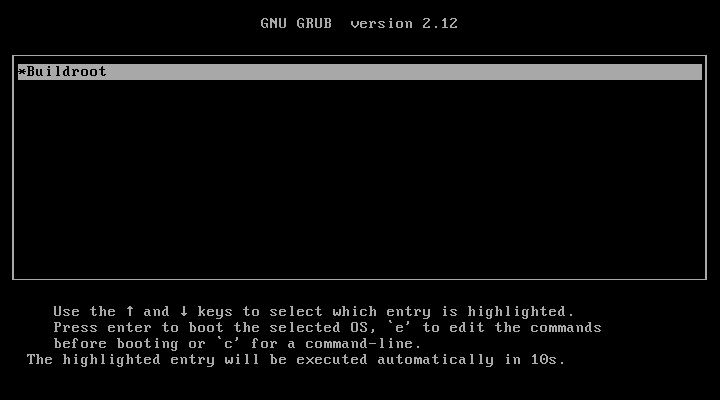

# BIOS ISO acceptance: partial evidence

Status on 2026-10-18: the application-created ISO reached its original BIOS GRUB menu in QEMU. Linux boot, console login, shell use, networking and graceful guest shutdown remain **unverified**. This is not full boot acceptance.

The capture shows the original `Buildroot` entry and ten-second timeout. No ISO bytes, menu entries or kernel arguments were changed for acceptance. QMP captured the real VGA framebuffer with no host display window. The PNG is a lossless format conversion of the retained PPM, not a reconstruction.

## Source and artifact binding

- Product revision: `5431a6275d875428ae50335905107d5951cc6150`.
- Buildroot archive: 2025.02, selected revision `aa2d7ca53f704af901f6c33c13e4bb1591886700`.
- Archive SHA-256: `33ba6d3f5907e18041a5ed079776cc9269df59703700427f93dc61c3387801c0`.
- Producer verified 14,709 archive entries with zero mismatches. This binds extracted bytes to the selected archive; independent upstream authentication remains separate.
- Final configuration SHA-256: `0e33a58b7dfbe2099d0cc6027f18dbce99650168936ce56cb5f71934137db51f`.
- Full producer terminal: succeeded, exit code 0; owned producer stopped.
- ISO: 12,357,632 bytes, SHA-256 `1d75d40b94e3c441aaaead9109f8074f62334931e1d84a576f3d7a36ec566dba`.
- Consumer: QEMU 7.2.15, Debian package `1:7.2+dfsg-7+deb12u12`, binary SHA-256 `7f8201fb6b24bbeb51512d65cc4a679336a80df0eadfc0926acda1929cf7f1f5`.
- Route: non-root Linux, read-only CD-ROM, PC BIOS, VGA, Unix QMP socket, no display window, no host port forwarding.

## Capture receipt

- Captured at `2026-10-18T07:08:16.999369+00:00` (UTC), 720 by 400 pixels.
- Raw `grub-menu.ppm` SHA-256: `5f3359bb801f913c1aa9575dc5b95d75f64d32696cb981dd4a76da1ac5e45b2e`.
- Converted `grub-menu.png` SHA-256: `4ccc4220e6c26db9b5089213aa2cd69c427b96792c55a9595623925d76853303`.
- Pixels inspected: only the generated guest's GRUB menu, no host user data, credentials or machine paths.
- The original source menu selects `linux __KERNEL_PATH__ root=/dev/sr0` and its initrd. No serial-console override was introduced.

## Consumer limitation

QEMU aborted with signal 6 and the exact diagnostic `../../tcg/tcg.c:3243: tcg fatal error`. The same terminal failure occurred with ordinary translation, one CPU and single-thread translation, and diagnostic single-instruction translation blocks. A persistent foreground consumer made the terminal result observable. An earlier client-lifecycle explanation was not established and is not the accepted cause.

The guest did not reach an inspected Linux console. Successful QMP input delivery and a `running` status do not establish guest progress. The original guest processes were verified absent after the aborts; the final two absence receipts were recorded at `2026-10-18T07:11:52.264885+00:00` and `2026-10-18T07:11:52.404387+00:00`. Aborted-process absence is not graceful guest shutdown evidence.

Next acceptance requires a functioning supported consumer runtime and the same immutable ISO. Repeat the original menu, Linux boot, login, architecture/kernel, basic filesystem and supported network checks, then guest shutdown and owned-process absence. The initramfs root is ephemeral; no persistence claim is made. Native Windows application and installer verification remain separate.
