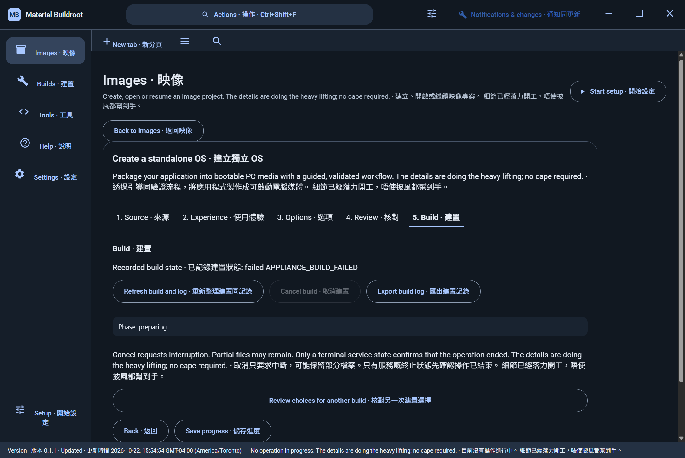

# Earlier standalone OS evidence

These originals retain their recorded source and producing time. They do not establish behavior in a later build.

## Preparation failure before structured diagnostics

Source: `8ae5a66bbb39929c75ff4585b2a5fbeffda56140`. Executable SHA-256: `63e364a2d58569c49f18a28de6ba4373422716f95aa039c882acbf20dc13f6c8`.

Captured at `2026-10-22T20:10:59.510Z` (UTC), dark bilingual mode, viewport 1440 by 962 at 150% scale. PNG SHA-256: `7cc0a102b733609f97d25f6d157d9416a7a97d047f358f4747c2ac4de15217c0`.

The running application stopped during preparation. No successful compilation, ISO, boot, workload health or export was established. The original is retained unchanged in the [capture inventory](captures.json).
