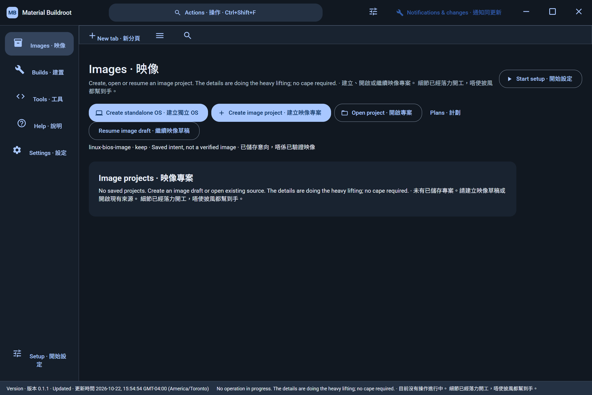
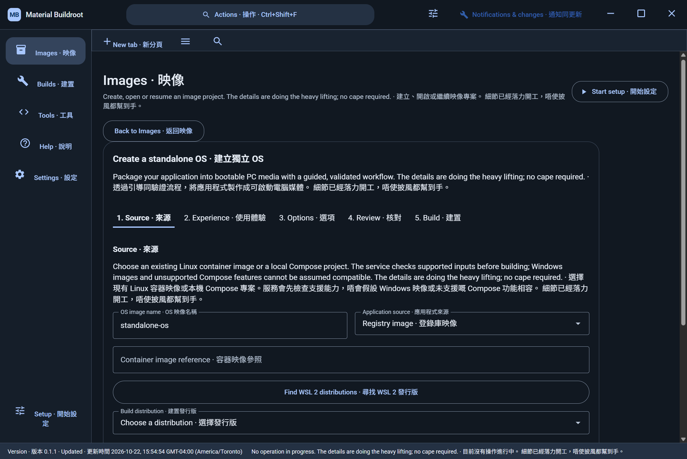
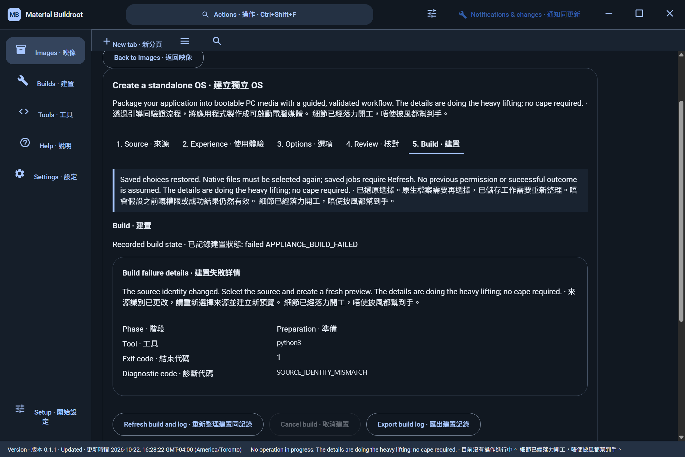
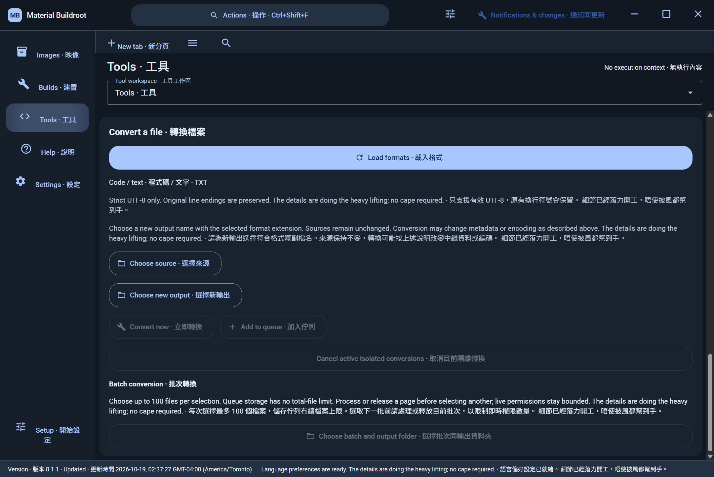
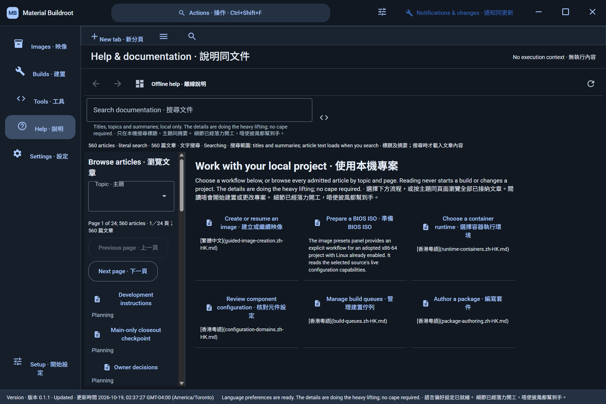

# Historical README interface evidence

The following original descriptions and dates are retained from `30dfb8481f83962c3a6b0e7a18d1126fa393cb64:README.md`. Relative links are adjusted for this archive. These screenshots do not depict the final current redesign.

These genuine screenshots were produced from source `8ae5a66bbb39929c75ff4585b2a5fbeffda56140` on 2026-10-22. The native run opened the standalone creator through its actual Images action without an adopted project. The [capture inventory](os-native/captures.json) binds the exact executable, screenshots, viewport and interaction evidence. A dedicated non-root WSL environment completed package setup through the application. The first registry workload attempt stopped during image preparation, before compilation; ISO production, boot, workload health, LAN, tunnels and persistence remain unverified.

The later diagnostic build, source `28272e3098fc0eed14238df27ed896f7bd7bbdf4`, completed a fresh GUI preview and build attempt on 2026-10-22. It stopped before compilation with `SOURCE_IDENTITY_MISMATCH`. The selected registry digest remained unchanged, so this diagnostic does not establish registry drift. The visible explanation is being refined alongside archive identity compatibility. This is evidence of the current limit, not a successful ISO build:

[Earlier standalone OS capture and provenance](os-native/ARCHIVE.md).

The following native screenshots come from the exact desktop build at `4c5e9ec4d9ed505bd3b715a0dad2882b1b2a6067`, running on an isolated hidden Windows desktop. Both show dark bilingual mode at an observed 1440 by 962 CSS pixels and device pixel ratio 1.5. Navigation and state observation are verified; conversion execution, the complete layout matrix and installed-update acceptance remain incomplete. The [capture inventory](main-closeout/captures.json) records exact source, executable and PNG identities.

[Historical interface screenshots and original provenance](ARCHIVE.md) are retained separately. Earlier native startup, dialogs and ISO console images do not depict the current guided interface.
